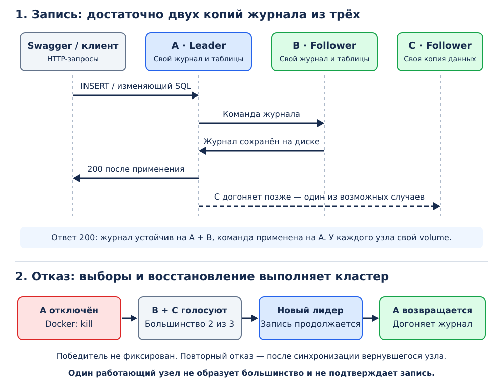

# Репликация и смена лидера в MiniClick

Трёхузловой кластер MiniClick использует OpenRaft для согласования записей,
автоматического выбора лидера и восстановления отставших узлов.

## Общая схема



## 1. Как устроен кластер

В Docker запускаются три экземпляра одного сервера MiniClick. Каждый хранит
собственную копию данных в отдельном volume. Общего каталога таблиц между
контейнерами нет.

В каждый момент установившейся работы один узел — `Leader`, остальные —
`Follower`. Лидер принимает запись, а остальные получают подтверждённые
изменения. Любой узел может обслуживать чтение своей локальной копии.

Для согласования используется готовая библиотека **OpenRaft 0.9.25**.
Она выполняет голосование, ведёт сроки лидерства (`term`), согласует журнал
и управляет его доставкой отстающим узлам. Отдельного координатора нет.
Интеграция с MiniClick включает HTTP-транспорт, устойчивое хранилище Raft,
применение команд к таблицам, конфигурацию и HTTP API.

Для выбора лидера и подтверждения записи требуется большинство — **два узла
из трёх**. После отказа одного узла кластер способен продолжить запись.
Один оставшийся узел большинство не образует и успешную запись не подтверждает.
Это защищает от независимой записи изолированного старого лидера.

Лидер не закреплён за `node1`. Победителя определяет Raft; фиксированной
последовательности `node1 → node2 → node3` нет.

## 2. Что и как реплицируется

Кластер включается секцией `[cluster]` в конфигурации. Реплицируются команды
`CREATE TABLE`, `DROP TABLE`, `OPTIMIZE TABLE` и отдельные HTTP-запросы INSERT.

Для INSERT в журнал попадают имя таблицы, формат и исходные байты запроса.
Получение схемы, разбор CSV/TSV/JSONEachRow и вставка выполняются при применении
команды. Поэтому конкурирующая смена таблицы не отделяется от порядка записей
в журнале. Ошибочные данные не оставляют частично вставленных строк.

Это **логическая репликация команд**: каждый узел самостоятельно применяет их
к своим таблицам и создаёт локальные parts MergeTree. Готовые parts между
участниками этого режима не копируются. Межузловые RPC передаются по HTTP
с JSON; отдельного gRPC-сервера и шардирования нет.

Путь успешного INSERT:

1. Клиент отправляет данные текущему лидеру.
2. OpenRaft добавляет команду в журнал и передаёт её другим узлам.
3. После устойчивой записи на большинстве команда становится подтверждённой.
4. Лидер применяет её к локальной таблице.
5. Клиент получает HTTP `200`. Followers применяют подтверждённый журнал
   в том же порядке и догоняют изменения.

Здесь используется **кворумное подтверждение записи**: успех зависит от
сохранения журнала на большинстве. Это не означает, что к этому моменту
все три узла уже обновили таблицы. Применение на отстающих followers происходит
позже. При отказе одного узла подтверждённые записи сохраняются в кластере,
пока сохранны диски оставшихся участников и работает протокол восстановления.

## 3. Что видит клиент

| Запрос или ситуация | Поведение |
|---|---|
| Успешная запись на лидере | `200`: журнал сохранён большинством, команда применена на лидере |
| Запись на follower при известном лидере | `409 NotLeader` с адресом лидера |
| Лидер ещё не выбран | Запись возвращает `503` |
| Не удалось дождаться большинства за 3 секунды | `503`, результат записи может быть неопределённым |
| Ошибочный ввод INSERT | `400`, таблица не получает частичных строк |
| SELECT на любом работающем узле | Чтение локального применённого состояния |

Сервер не перенаправляет запись и не повторяет её автоматически. После `503`
по таймауту команда может позже подтвердиться; слепой повтор INSERT способен
создать дубли. Дедупликация клиентских повторов не реализована.

Чтение **не является линейризуемым**. Follower может отставать, а изолированный
старый лидер — возвращать старую локальную копию. Актуальность копии проверяется
по `last_applied` и содержимому строк. Свежие записи доступны на действующем
лидере после успешного INSERT.

## 4. Как меняется лидер

Лидер регулярно отправляет служебные сообщения. Если связь с ним пропадает,
участники начинают выборы. Кандидат получает голоса с учётом актуальности
журнала; одного объявления себя лидером недостаточно.

OpenRaft настроен на heartbeat 150 мс и интервал таймаута выборов 600–1000 мс.
Это параметры протокола, а не гарантия времени переключения: сеть, нагрузка
и повторные выборы могут увеличить ожидание. Завершение переключения
определяется по статусам узлов.

После аварийного завершения лидера два оставшихся узла выбирают нового
и продолжают подтверждать записи. Потеря большинства останавливает
подтверждение новых записей, даже если узел ещё показывает роль `Leader`.

Когда прежний лидер запускается снова с тем же volume, он загружает сохранённое
состояние Raft и подключается к действующему кластеру. Журнал согласуется
с лидером; неподтверждённый конфликтующий хвост может быть заменён.
Вернувшийся узел получает недостающие записи или снимок и применяет изменения.
Вручную менять его роль, адрес лидера или конфигурацию не требуется.

Повторный отказ проверяется после возврата и синхронизации ранее остановленного
узла. Иначе при отключении ещё одного участника
останется только один работающий узел без большинства.

## 5. Как данные переживают рестарт

В `/data` каждого узла находятся:

| Файл или каталог | Назначение |
|---|---|
| `cluster-identity.json` | Идентичность узла, идентификатор кластера и его состав |
| `raft-log.json` | Голоса, журнал Raft и служебные индексы |
| `raft-state.json` | История применённых команд, `last_applied` и состав участников |
| `view/` | Локальный каталог и файлы таблиц, восстановленные из истории |

JSON-документы записываются через временный файл, `fsync`, `rename` и `fsync`
родительского каталога. Голоса и записи журнала сохраняются до подтверждения
соответствующей операции библиотеке Raft.

При применении подтверждённой команды сначала сохраняется новая история
в `raft-state.json`, затем изменяется локальная таблица. При запуске `view/`
создаётся заново и история проигрывается до открытия HTTP-сервера. Поэтому
авария между этими действиями не требует угадывать, завершился ли INSERT:
мы восстанавливаем таблицы из истории, а не повторяем вставку поверх старых parts.

Для догоняния после удаления старых записей журнала используется снимок.
В нашей реализации он содержит историю команд и служебное состояние.
Установка снимка восстанавливает каталог под блокировкой читателей:
SELECT не видит промежуточный набор таблиц.

## 6. Границы реализации и прежний режим

Это учебное хранилище Raft: история команд растёт, JSON-файлы переписываются,
а запуск и установка снимка требуют повторного исполнения команд. Расход
памяти и время восстановления растут с историей. Снимки позволяют очищать
журнал Raft, но не сокращают историю в `raft-state.json`.

Состав фиксирован: три участника с постоянными id и адресами. Динамического
добавления узлов, автоматической миграции старых данных, TLS и авторизации нет.
Менять id или `members` у существующего volume нельзя. `view/` нельзя править
как независимый источник данных. Все контейнеры демо работают на одном хосте,
поэтому отказ всего компьютера здесь не моделируется.

Без `[cluster]` сохранён прежний режим с фиксированными ролями:

| Свойство | Фиксированные `Leader`/`Replica` | Режим `[cluster]` |
|---|---|---|
| Назначение лидера | Вручную в конфигурации | Выборы OpenRaft |
| Передача изменений | Реплика опрашивает `/replica/*` и скачивает parts | Журнал команд и снимки |
| Подтверждение записи | Без ожидания реплики | Устойчивая запись на большинстве |
| Возврат отставшего узла | Повторная сверка с заданным лидером | Согласование с текущим лидером |
| Memory | Переносятся пустые описания, строки не копируются | Строки входят в историю и восстанавливаются |

В Compose используется только `[cluster]`. Старый цикл копирования
parts одновременно с ним не запускается. Основная интеграция находится
в [модуле cluster](../crates/server/src/cluster/mod.rs), хранение —
в [log_store.rs](../crates/server/src/cluster/log_store.rs) и
[state_machine.rs](../crates/server/src/cluster/state_machine.rs).

## 7. Интерфейсы демонстрации

SQL-запросы, загрузка данных и проверка статусов выполняются через Swagger UI.
Терминал используется для запуска, аварийного отключения и возврата контейнеров.

Каждая вкладка Swagger обращается к одному узлу. Автоматического переключения
на нового лидера нет: запросы после отказа отправляются через вкладку
работающего узла. INSERT описан как `application/octet-stream` с бинарным телом;
CSV передаётся через поле выбора файла.

Конфигурации и роли при переключениях не изменяются вручную.

## 8. Подготовка демонстрации

Нужны Docker Engine, Compose v2 или новее и браузер. Rust на хосте не требуется;
образ собирается на Rust 1.96 / Debian Bookworm. Первую сборку с загрузкой
зависимостей выполните заранее, из корня репозитория:

```bash
docker compose build
```

| Узел / сервис Compose | id | Swagger на хосте | Конфигурация |
|---|---:|---|---|
| `node1` | 1 | http://localhost:8123/swagger-ui | [node1.toml](../deploy/node1.toml) |
| `node2` | 2 | http://localhost:8124/swagger-ui | [node2.toml](../deploy/node2.toml) |
| `node3` | 3 | http://localhost:8125/swagger-ui | [node3.toml](../deploy/node3.toml) |

Именованные volumes — `node1-data`, `node2-data`, `node3-data`; внутренние
адреса — `node1:8123`, `node2:8123`, `node3:8123`. При занятых портах задайте
`MINICLICK_NODE1_PORT`, `MINICLICK_NODE2_PORT`, `MINICLICK_NODE3_PORT` для команд
Compose и используйте соответствующие адреса в браузере.

Для загрузки в Swagger используются три готовых CSV-файла. Они передаются
отдельно и в Git не хранятся:

| Файл | Строки | Этап |
|---|---|---|
| `first.csv` | 1–3 | Первая запись |
| `second.csv` | 4–5 | После первого переключения |
| `third.csv` | 6 | После второго переключения |

Файлы без заголовка, колонки идут в порядке `id,value`.

Если ещё работают контейнеры прежнего двухузлового Compose, освободите их порты:

```bash
docker compose down --remove-orphans
```

Volumes при этом сохраняются. Старые `leader-data`/`replica-data` автоматически
не импортируются в новый кластер. **Не используйте `down -v` для обычной
подготовки или рестарта: эта команда удаляет данные.**

## 9. Запуск и определение лидера

В терминале:

```bash
docker compose up -d --wait
docker compose ps
```

Откройте три вкладки Swagger из таблицы выше. Для HTTP-вызовов раскрывайте
нужный endpoint, нажимайте **Try it out**, затем **Execute**. Ответ смотрите
в **Server response**, а не только в разделе с примерами ответов.

На каждом узле выполните `GET /cluster/status`.

Если это совершенно новый кластер и он ещё ни разу не инициализировался,
все узлы будут `Learner` без лидера. Тогда **один раз на одном узле** выполните
`POST /cluster/init`, затем повторите статусы до выбора лидера.

Если volumes уже использовались, кластер восстанавливается самостоятельно.
Повторять init не нужно; ответ `409` на повторную инициализацию ожидаем.

| Поле статуса | Что означает |
|---|---|
| `id`, `role` | Какой это узел и его текущая роль |
| `leader`, `leader_addr` | Известный узлу лидер и его внутренний адрес Docker |
| `term` | Текущий срок выборов |
| `last_log_index` | Последняя имеющаяся запись журнала |
| `last_applied` | Последняя применённая запись; это не число строк |
| `snapshot`, `purged` | Индексы снимка и удалённой части журнала |
| `healthy` | Нет зафиксированной ошибки Raft/представления; не гарантия большинства |

Выберите вкладку узла с ролью `Leader`. В установившемся состоянии остальные
показывают того же лидера. Следующие запросы записи выполняются на этом узле.

## 10. Таблица и первые данные

На вкладке лидера откройте `POST /query`: формат ответа `TSV`, тело `text/plain`.
Если таблица осталась от предыдущего показа, сначала явно удалите **только
демонстрационную таблицу** запросом `DROP TABLE election_demo` на лидере.
Затем выполните:

```sql
CREATE TABLE election_demo (id UInt64, value String)
ENGINE = MergeTree ORDER BY id
```

Не используйте `IF NOT EXISTS`, чтобы случайно
не продолжить показ поверх старых строк.

Далее в `POST /insert/{table}` укажите `table = election_demo`, `format = CSV`
и выберите `first.csv` в поле загрузки тела. Нажмите Execute.
Успешный ответ — `200` и `Ok.`.

Через `POST /query` выполните на каждом из трёх узлов:

```sql
SELECT id, value FROM election_demo ORDER BY id
```

Ожидаемый результат на каждом узле: ровно `1/alpha`, `2/beta`, `3/gamma`.
Если follower ещё отстаёт, повторите статус и SELECT.

## 11. Аварийное отключение лидера

В терминале сохраните имя фактического лидера. Ниже пример для `node1`:

```bash
FIRST=node1
docker compose kill "$FIRST"
docker compose ps --all
```

`kill` аварийно завершает процесс, сохраняя volume. Вкладка остановленного
узла больше не отвечает. На двух оставшихся повторяйте `GET /cluster/status`
до появления нового `Leader`. Ожидаемый результат: смена `leader` и рост `term`.

На новом лидере сначала выполните прежний SELECT — первые три строки должны
сохраниться. Затем через `POST /insert/{table}` загрузите `second.csv`.
Повторный SELECT должен показать пять строк, включая `4/delta` и `5/epsilon`.

## 12. Возврат первого узла

В терминале:

```bash
docker compose start "$FIRST"
docker compose ps
```

Вернитесь в его вкладку Swagger, выполните статус и SELECT. Дождитесь всех
пяти строк. Убедитесь, что вернувшийся узел и вторая реплика догнали журнал
текущего лидера по `last_applied`.

Следующий отказ проверяется только после завершения восстановления.

## 13. Второе переключение и итог

Сохраните имя текущего лидера и отключите его. Например, если победил `node3`:

```bash
SECOND=node3
docker compose kill "$SECOND"
```

На двух оставшихся узлах проверьте выбор нового лидера. Победителем
может оказаться и первый вернувшийся узел. На вкладке нового лидера проверьте
пять строк, затем загрузите `third.csv`.

Верните второй остановленный узел:

```bash
docker compose start "$SECOND"
```

После догоняния выполните SELECT во всех трёх вкладках. В каждом ответе
должен быть одинаковый набор **без потерь и дублей**:

```text
1   alpha
2   beta
3   gamma
4   delta
5   epsilon
6   zeta
```

Проверяйте значения и состав строк: одного `count() = 6` для этого недостаточно.

## 14. Полный рестарт, остановка и диагностика

Для дополнительной проверки дискового восстановления после синхронизации
всех трёх узлов выполните:

```bash
docker compose restart
```

Дождитесь доступности узлов и выборов, повторите SELECT в Swagger. Init после
этого не выполняется; все шесть строк должны сохраниться.

Для завершения показа достаточно остановить контейнеры:

```bash
docker compose stop
```

Для диагностики:

```bash
docker compose ps --all
docker compose logs --tail 30 node1 node2 node3
```

Если остановлены два узла, восстановите хотя бы один и дождитесь выборов:
без большинства запись подтверждаться не будет. При `409` проверьте, в какую
вкладку отправляете INSERT. При `503` проверьте лидера и доступность участников,
а затем установите результат предыдущего INSERT перед его повтором.
